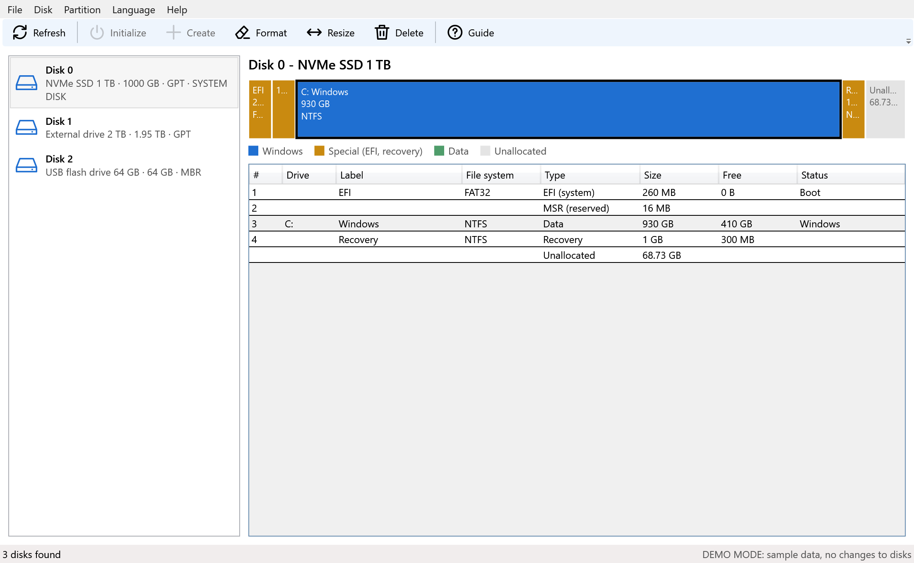

<p align="center">
  
</p>

<h1 align="center">CandeDisk</h1>

<p align="center">
  A disk and partition manager for Windows: format, create, delete and resize with a simple interface.
</p>

<p align="center">
  <a href="README.md">Italiano</a> · <b>English</b>
</p>



> The screenshot uses **demo mode** with sample data, not real disks. The interface is currently in Italian.

## Why CandeDisk

Windows *Disk Management* sometimes gets in the way: "Delete Volume" greyed out on some partitions, "Extend" disabled without explanation, unclear errors. CandeDisk uses the same Windows storage functions, but:

- shows **all disks, partitions and unallocated space** in one view, with a colour-coded map;
- can delete **protected partitions** (EFI, OEM, recovery) through `diskpart`, after explicit confirmations;
- shows readable errors and keeps an **operation log**;
- **protects** you from the worst mistakes (it won't touch the running Windows or the boot partition).

## Features

- Disk and partition list with file system, free space and status
- Clickable proportional disk map
- Initialize new disks (GPT)
- Create partitions in unallocated space (NTFS, exFAT, FAT32)
- Format (quick or full)
- Resize (shrink or extend) within the limits Windows reports
- Delete, including protected partitions
- Built-in help (`F1`), operation log, copy summary to clipboard

## Requirements

- Windows 11 (64-bit), where it has been tested. Windows 10 should work (same storage functions) but is **not verified**.
- **Administrator** rights to change disks (read-only otherwise)

## Install

Download the latest release from [**Releases**](https://github.com/candelab2026/candedisk/releases), extract the zip and run `CandeDisk.exe`. The release includes the .NET runtime.

## Build from source

Requires the [.NET 9 SDK](https://dotnet.microsoft.com/download).

```powershell
git clone https://github.com/candelab2026/candedisk.git
cd candedisk
dotnet build src/CandeDisk -c Release
dotnet run --project src/CandeDisk
```

Use `CandeDisk.exe --demo` to explore the interface without touching any disk.

## Safety

Disk operations **permanently erase data**. Always back up first. The software is provided **without any warranty** (see [LICENSE](LICENSE)). Try it on a virtual disk or a spare USB drive before using it on important data.

## Known limitations

Moving partitions is not supported; dynamic disks and software RAID are not handled.

## Contributing

See [CONTRIBUTING.md](CONTRIBUTING.md). Report vulnerabilities as described in [SECURITY.md](SECURITY.md).

## License

[MIT](LICENSE) © 2026 CandeLab.
